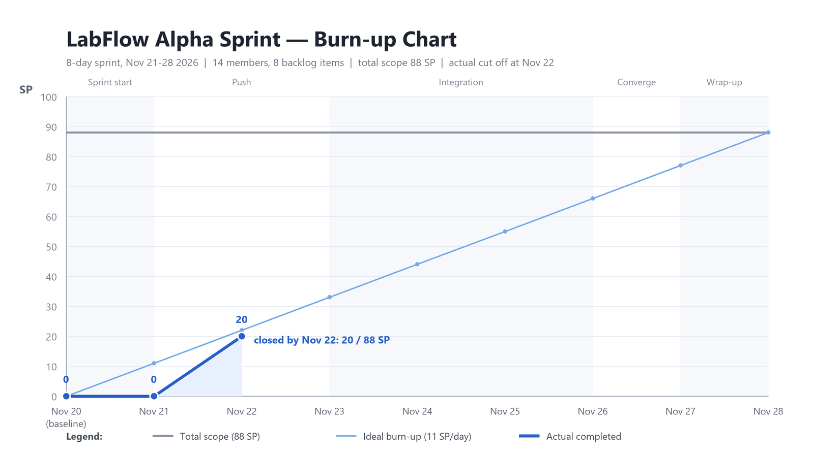
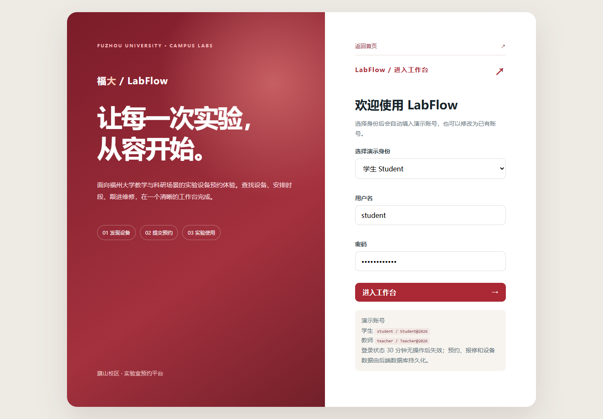
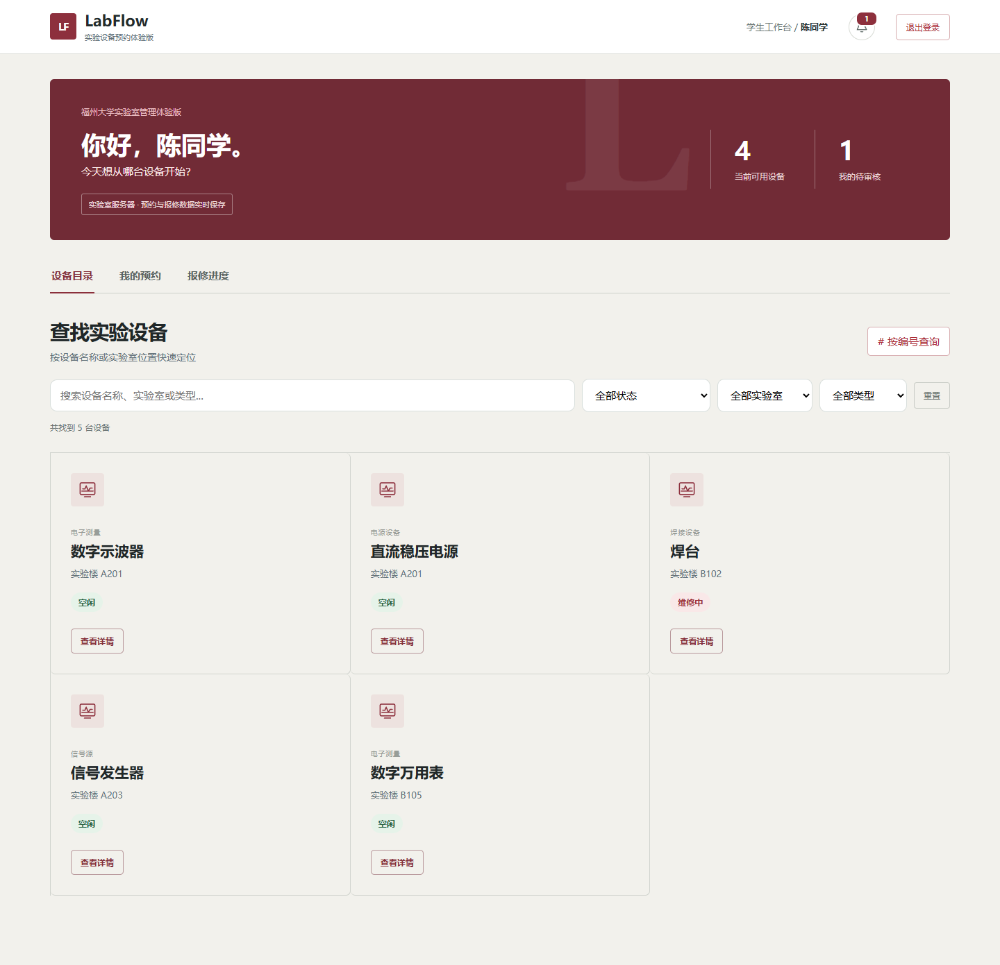
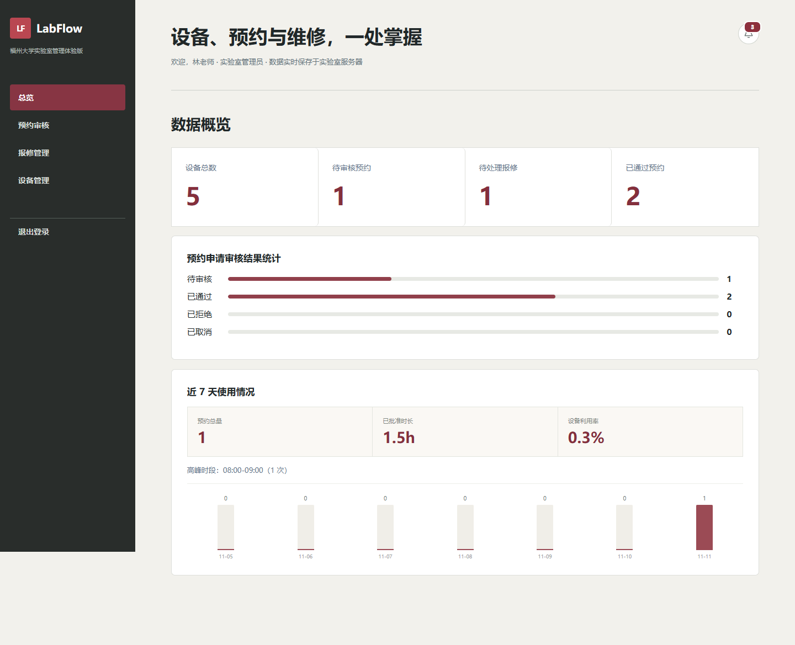
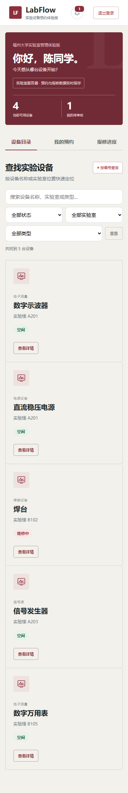

# EE308FZ · Fifth Assignment · Alpha Sprint · Sprint Essay 1 (Day 1–2)

| Item | Content |
| --- | --- |
| Course | EE308FZ Software Engineering |
| Assignment | Fifth Assignment — Alpha Sprint |
| Assignment link | https://bbs.csdn.net/topics/620611106 |
| This post | Sprint Essay 1, covering **Nov 21–22, 2026** (sprint runs Nov 21–28) |
| Team / product | **LabRunners** (14 members) — **LabFlow**, campus laboratory equipment reservation platform |
| Repository | `https://github.com/YEPM17/LabFlow` |
| Goal of this assignment | Report the real progress of the last two sprint days: burn-up chart, latest running state of the system, and per-member deliverables with Issue/commit or test evidence |
| References | Alibaba Java Development Manual (Ultimate Edition v1.3.0, used as the naming/style baseline); Conventional Commits 1.0.0; Node.js 24 documentation; OWASP ASVS 4.0 (authentication and session controls); the team's SRS and code-standard essay |

---

## 1. Sprint goal and scope

LabFlow already had a runnable full-stack prototype before the sprint: a browser front end (home page, student workspace, teacher workspace, mobile layout) and a zero-dependency Node.js back end (`node:http` + `node:sqlite`) exposing a REST API with authentication, device catalog, reservation workflow, repair workflow, notifications and statistics.

The Alpha sprint does **not** rebuild the system. Its goal is to move the prototype to an *acceptance-ready* build in eight days:

> **Sprint goal:** by Nov 28, LabFlow can be deployed on a clean machine in one step, the scan-code entry closes the loop from device label to prefilled booking, notifications and statistics match the SRS wording, and a regression suite runs green before every merge.

The scope was frozen on Day 1 into eight backlog items, **88 story points** in total. Because the team has 14 members, each item was split into sub-tasks with a single owner, so every member has one Issue and one verifiable deliverable.

| ID | Backlog item | SP | Phase |
| --- | --- | --- | --- |
| LF-A1 | One-step deployment and health verification | 10 | Push (Nov 22) |
| LF-A2 | Scan-code closed loop (label → query → prefilled booking) | 18 | Push → Integration |
| LF-A3 | Reservation main-flow front-end/back-end alignment | 10 | Integration (Nov 24) |
| LF-A4 | Notification rules correction | 6 | Integration (Nov 25) |
| LF-A5 | Statistics correction (utilization, peak hours) | 6 | Integration (Nov 25) |
| LF-A6 | Compatibility, responsive and accessibility hardening | 12 | Converge (Nov 26) |
| LF-A7 | Regression suite and test report | 16 | Converge (Nov 26) |
| LF-A8 | Documentation directory, runbook and sprint records | 10 | Push (Nov 22) |

Sprint schedule (8 days, plus submission day):

| Date | Phase | Key actions |
| --- | --- | --- |
| Nov 21 (Sat) | Kick-off | Freeze LF-A1–A8, local environment ready |
| Nov 22 (Sun) | Push | Go live (LF-A1), scan-code design frozen (LF-A2), docs directory (LF-A8) |
| Nov 23 (Mon) | Push | Scan-code loop development (LF-A2), rule alignment |
| Nov 24 (Tue) | Integration | Front-end/back-end integration (LF-A2/A3), testing joins, standards review |
| Nov 25 (Wed) | Integration | Notification and statistics fixes (LF-A4/A5), compatibility |
| Nov 26 (Thu) | Converge | Feature freeze (A1–A6), regression (LF-A7), draft complete for internal review |
| Nov 27–28 | Wrap-up | Defect burn-down, final regression, submission |

Definition of Done for every sub-task: code merged through a reviewed pull request, the related Issue closed, at least one automated check green, and the behaviour reproducible from the runbook on a clean machine.

---

## 2. Burn-up chart



| Date | Planned cumulative (SP) | Actual cumulative (SP) | Closed on that day |
| --- | --- | --- | --- |
| Nov 20 (baseline) | 0 | 0 | — |
| Nov 21 | 11 | 0 | Sprint setup, environment, no item closed |
| Nov 22 | 22 | **20** | LF-A1 (10), LF-A8 (10) |
| Nov 23 | 33 | — | planned |
| Nov 24 | 44 | — | planned |
| Nov 25 | 55 | — | planned |
| Nov 26 | 66 | — | planned |
| Nov 27 | 77 | — | planned |
| Nov 28 | 88 | — | planned |

**Reading the chart.** The flat grey line is the frozen scope, 88 SP, i.e. 11 SP per day for eight days. The blue line is the ideal burn-up. The dark line is what is actually completed.

Two days in, the team has closed **20 of 88 SP (22.7%)** against a plan of 22 SP (25%), i.e. **2 SP behind**. The gap is fully explained by Day 1: it was deliberately reserved for task freezing and environment parity across 14 machines, so nothing could be closed. Day 2 recovered 20 SP in a single day, which is why the actual segment is steeper than the ideal line. No scope change has been requested, so the 2 SP have to be recovered in the Integration phase (Nov 24–25) rather than by cutting scope.

---

## 3. Day 1 — Nov 21: kick-off, freeze, environment

**What we did**

1. **Sprint planning (about 2.5 hours, 14 people).** Walked through the SRS deviation list produced before the sprint, converted it into eight backlog items, split each item into sub-tasks with a single owner, estimated them with planning poker (three rounds), and froze LF-A1–A8. Anything outside the eight items went to the next sprint. Roles from the prototype phase were kept, so nobody had to learn a new area in sprint week.
2. **Ownership and board.** One owner per sub-task, GitHub Projects with `Todo / In Progress / In Review / Done`, an Issue template carrying acceptance criteria and an "evidence" field (commit link or test report).
3. **Working agreements for 14 people.** Five workstreams (project management, design, student-side front end, teacher-side front end, logic and testing), short-lived branches `feat/LF-A2-scan`, `fix/LF-A4-notify`, Conventional Commits, no direct push to `main`, one Issue per pull request, and two reviewers per pull request to keep the review queue from becoming the bottleneck.
4. **Environment parity.** The lab machines ship Node.js 22 while the project declares `engines: >=24` (it relies on the built-in `node:sqlite`). A portable Node.js 24 runtime was pinned in the repo tooling folder and documented, so a fresh machine needs no global installation. `.env.example`, demo accounts and the local database were verified on every member's machine.

**Outcome:** 0 SP closed. This is expected for a kick-off day and is visible as the flat segment on the burn-up chart.

---

## 4. Day 2 — Nov 22: first increment

**LF-A1 · One-step deployment and health verification — closed (10 SP)**
The server was brought up from a clean checkout on a second machine using only the documented command: the schema and seed data were created automatically, the static front end was served from the same origin, and the health endpoint answered. Today's verification run:

```
GET http://127.0.0.1:3100/api/health   → 200
{"status":"ok","database":"ok","time":"2026-11-22T12:03:45.497Z"}
GET http://127.0.0.1:3100/index.html   → 200 (6385 bytes)
node --test                            → # tests 14  # pass 14  # fail 0  (1.16 s)
```

**LF-A8 · Documentation directory, runbook and sprint records — closed (10 SP)**
The `docs/` directory was reorganised into `API.md` (endpoint contract, error codes, role matrix) and `ARCHITECTURE.md` (layering, data model, state machines, security controls, production migration notes); the runbook was completed in `README.md` (prerequisites, one-step start command, environment variables, data reset, three demo accounts); and the sprint records (board, Issue index, blog link index) were created. This is the artefact the defence and the final report will cite.

**LF-A2 · Scan-code design frozen (not closed, 0 SP closed)**
The front end already had a "query by device number" entry, so the sprint does not add a second scanner: it closes the loop around the existing one. The design review with the whole team froze five decisions:

- **Payload**: a QR label on each device carries the device ID and a short checksum, so a label from another room or a stale label is rejected before any request is made.
- **Route**: scan → resolve device → open the reservation panel with the device pre-selected; the manual input box stays as the fallback for damaged labels.
- **Permissions**: a scan never bypasses the API. The prefilled panel only calls `GET /devices/:id/availability`, which already hides other students' identities.
- **Failure path**: unknown or checksum-invalid codes show a recoverable message instead of a page error.
- **Scope guard**: scanning only prefills; it never creates a reservation by itself, so LF-A2 cannot collide with the LF-A3 integration.

Design document: [docs/SCAN-CODE.md](https://github.com/YEPM17/LabFlow/blob/main/docs/SCAN-CODE.md). Implementation starts on Nov 23, which is why the item is still open.

**Cross-check on the regression baseline**
The existing end-to-end suite was re-run so the sprint did not start on a broken base: 14 subtests, 14 passed, 0 failed, 1.16 s. Coverage includes health and static hosting, public device status, authentication rejection, catalog filters, reservation creation and conflict detection, approval, cancellation and the cancel-cutoff window, the repair workflow with photo storage and device state, delete protection with name snapshots, administrator protection, weekly statistics, the 15-minute reminder scheduler, and notification read plus logout invalidation.

---

## 5. Latest running state

Captured from the build that answered `/api/health` above.

| Login | Student workspace |
| --- | --- |
|  |  |

| Teacher overview | Mobile layout |
| --- | --- |
|  |  |

The deployed build is the same code path as the pre-sprint acceptance run, which was exercised in a headless browser at 1280, 1366, 1440 and 1920 px with no horizontal overflow on the home, student and teacher pages, and no JavaScript page errors.

Note the `# 按编号查询` control at the top right of the student workspace: this is the existing entry point that LF-A2 closes the loop around. The sprint does not add a second scanner, it makes this entry produce a prefilled, permission-checked reservation panel. UI copy is still Chinese in this build; bilingual copy is a post-Alpha item.

---

## 6. Division of work and evidence (Nov 21–22)

| Student ID | Member | Sprint sub-task | SP | Closed by Nov 22 | Evidence |
| --- | --- | --- | --- | --- | --- |
| 832401202 | 陈文俊 | LF-A1 deployment lead (6) + LF-A8 sprint records (4) | 10 | 10 | [#1](https://github.com/YEPM17/LabFlow/issues/1) → [3603ecd](https://github.com/YEPM17/LabFlow/commit/3603ecd02841a70798664840ad1674447383ef8a) |
| 832401216 | 聂迪非 | LF-A2 scan flow and information architecture, design freeze | 5 | 0 | [#2](https://github.com/YEPM17/LabFlow/issues/2) · `docs/SCAN-CODE.md` |
| 832401220 | 王梓涵 | LF-A2 scan entry UI and prefilled panel design | 4 | 0 | [#2](https://github.com/YEPM17/LabFlow/issues/2) |
| 832401227 | 周琰昭 | LF-A2 failure states and fallback design | 4 | 0 | [#2](https://github.com/YEPM17/LabFlow/issues/2) |
| 832402106 | 黄嘉轩 | LF-A7 usability walkthrough and consistency regression | 8 | 0 | [#7](https://github.com/YEPM17/LabFlow/issues/7) |
| 832402114 | 刘明泽 | LF-A2 prefilled reservation panel implementation | 5 | 0 | [#2](https://github.com/YEPM17/LabFlow/issues/2) |
| 832401222 | 吴浩宇 | LF-A6 student-side compatibility fixes | 4 | 0 | [#6](https://github.com/YEPM17/LabFlow/issues/6) |
| 832402210 | 靳立一 | LF-A4 teacher-side notification and review prompts | 6 | 0 | [#4](https://github.com/YEPM17/LabFlow/issues/4) |
| 832401204 | 何淞源 | LF-A5 statistics board correction | 6 | 0 | [#5](https://github.com/YEPM17/LabFlow/issues/5) |
| 832401224 | 谢宇城 | LF-A3 reservation main-flow integration | 10 | 0 | [#3](https://github.com/YEPM17/LabFlow/issues/3) |
| 832401214 | 彭孟欢 | LF-A1 data initialisation (4) + LF-A7 repair-chain regression (4) | 8 | 4 | [#1](https://github.com/YEPM17/LabFlow/issues/1) → [3603ecd](https://github.com/YEPM17/LabFlow/commit/3603ecd02841a70798664840ad1674447383ef8a) |
| 832401215 | 刘冉 | LF-A6 responsive and accessibility hardening | 8 | 0 | [#6](https://github.com/YEPM17/LabFlow/issues/6) |
| 832402108 | 解皓喆 | LF-A7 multi-device regression and test report | 8 | 0 | [#7](https://github.com/YEPM17/LabFlow/issues/7) |
| 832401109 | 程思扬 | LF-A8 documentation directory and screenshot evidence | 6 | 6 | [#8](https://github.com/YEPM17/LabFlow/issues/8) → [3603ecd](https://github.com/YEPM17/LabFlow/commit/3603ecd02841a70798664840ad1674447383ef8a) |
| — | **Total** |  | **88** | **20** |  |

**Where the 20 SP came from.** LF-A1 (10 SP) and LF-A8 (10 SP) were the only two items whose acceptance criteria could be met inside two days, because both depend on the environment rather than on new code. Everything else is in `In Progress`: the scan-code design is frozen but its implementation starts on Nov 23, and A3–A7 cannot close before integration.

One documentation defect surfaced during deployment verification: `docs/API.md` published the health path as `/health`, while the router registers `/api/health` (today's probe returned 404 on `/health` and 200 on `/api/health`). It is a documentation defect rather than a code defect, but it is exactly the class of issue that the LF-A1 acceptance criterion ("reproducible from the runbook only") is meant to catch. The runbook now states the correct path and the `API.md` correction is tracked as a separate Issue.

---

## 7. Risks and mitigations

| Risk | Impact | Mitigation |
| --- | --- | --- |
| Node version mismatch between lab machines (22) and project requirement (24) | Deployment fails on a clean machine, LF-A1 cannot be reproduced | Portable pinned runtime plus documented prerequisite; verified on a second machine before closing LF-A1 |
| Fourteen people touching one small codebase | Merge conflicts, review queue becomes the bottleneck | One owner per sub-task, five workstreams on separate files, two reviewers per PR, no direct push to `main` |
| QR payload semantics differ between front end and back end | Scan loop breaks during integration on Nov 24 | Payload and checksum frozen in `docs/SCAN-CODE.md` before any code |
| The 2 SP slip from Day 1 accumulates | Regression squeezed at the end of Converge | Buffer of two days (Nov 27–28); Nov 25 carries no new items beyond A4/A5 |
| Single shared SQLite file in the demo environment | Concurrent demo sessions produce confusing results | Reset procedure in the runbook; demo seeding script kept separate from test databases |

---

## 8. Next two days (Nov 23–24)

- **Nov 23:** implement the scan-code loop (LF-A2) end to end — payload parsing and validation, device resolution, prefilled reservation panel, recoverable error states; align the reservation rule wording with the SRS (open hours, 30-minute step, 0.5–4 h, cancel cutoff), because the front-end copy and the API messages currently differ in phrasing. Testing starts writing the UI smoke cases in parallel so Nov 24 is integration only.
- **Nov 24:** front-end/back-end integration for LF-A2/LF-A3, the first Playwright smoke flow (scan → prefetch availability → booking created) running in the pipeline, and a standards review against the code-standard essay (naming, error shape, commit messages).
- Expected closing: LF-A2 (18 SP) plus the LF-A3 integration part, moving actual to about 40–45 SP, back on or slightly ahead of the ideal line.

---

## 9. Appendix — links

| Purpose | Link |
| --- | --- |
| Repository | `https://github.com/YEPM17/LabFlow` |
| Sprint board / task index | [Issues #1–#14](https://github.com/YEPM17/LabFlow/issues) |
| Membership post | `<link>` |
| Deployment runbook | `README.md` (quick start, configuration, reset) |
| Scan-code design | `docs/SCAN-CODE.md` |
